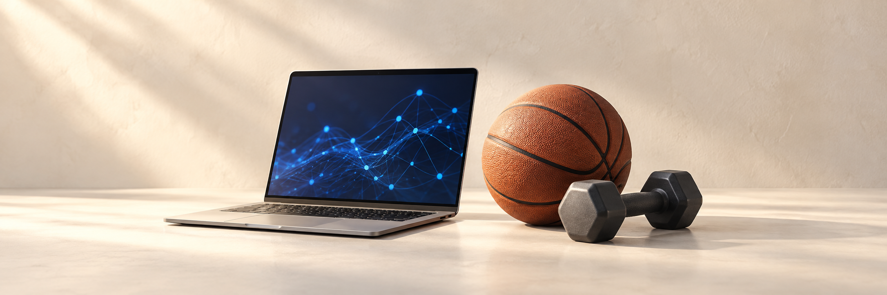

<!-- README:LANG=zh-CN -->
<!-- README:COMMUNITY-FIRST -->

<strong>简体中文</strong> · <a href="README.md">English</a>

<h1 align="center">AI 薄肌俱乐部</h1>

<strong>练模型，也练身体。</strong> 一个面向 AI 科研人员的打卡与经验交流社区。

**[开始打卡 →](https://github.com/Al-LeanMuscle-Club/AI-LeanMuscle-Club/issues/new?template=daily-checkin.yml)** · [分享经验](https://github.com/Al-LeanMuscle-Club/AI-LeanMuscle-Club/issues/new?template=experience.yml) · [随便聊聊](https://github.com/Al-LeanMuscle-Club/AI-LeanMuscle-Club/issues/new?template=community-chat.yml)

[打卡与计分说明](docs/MEMBER_GUIDE.zh-CN.md) · [打卡辅助页][member-helper]

## News · 精选经验分享

> **专题文章 · 发起人的十年科研与运动实践**
>
> **[研究 AI 十年了，模型越来越强，我们自己呢？](docs/articles/ai-lean-muscle-club/AI-Lean-Muscle-Club.zh-CN.md)**
>
> [@yukang2017](https://github.com/yukang2017) 的十年科研生活回顾：DDL 期间怎样调整训练、忙完后如何恢复、怎样把饭吃得省事，以及 Agent 扣除检查与返工后省下的时间，能否留给运动和休息。也谈到 AI 薄肌俱乐部的发起初衷。
>
> **[中文原文](docs/articles/ai-lean-muscle-club/AI-Lean-Muscle-Club.zh-CN.md) · [Read in English](docs/articles/ai-lean-muscle-club/AI-Lean-Muscle-Club.en.md)**

社区成员的亲身实践。点击标题，到原帖接着聊。

**[脂包肌减重3个体会](docs/experiences/2026-10-27-andysonys.md)** [@AndysonYs](https://github.com/AndysonYs) · 半年从250斤减到210斤，聊极端节食的代价、少量训练的正反馈，以及旅行中的“快乐热量比”。

**[程序员到底怎么练？万字健身指南](https://github.com/Al-LeanMuscle-Club/AI-LeanMuscle-Club/issues/57)** [@orange90](https://github.com/orange90) · 从个人健身经历出发，聊正反馈与忙碌工作中的训练安排。

**[减肥 30 kg：从喜欢的运动开始](https://github.com/Al-LeanMuscle-Club/AI-LeanMuscle-Club/issues/35)** [@rentainhe](https://github.com/rentainhe) · 从篮球开始，逐步建立运动和饮食习惯。[阅读整理](docs/experiences/2026-10-24-rentainhe.md)

**[让 agent 跑实验，我下楼练一会](https://github.com/Al-LeanMuscle-Club/AI-LeanMuscle-Club/issues/44)** [@Aaronhuang-778](https://github.com/Aaronhuang-778) · 利用任务运行的间隙运动，也给休息留些时间。

**[Early Bird：从一起吃早餐开始](https://github.com/Al-LeanMuscle-Club/AI-LeanMuscle-Club/issues/42)** [@ChawDoe](https://github.com/ChawDoe) · 结伴早餐与群内接龙，让规律作息有个伴。

**[赶 DDL，也给生活留点空间](https://github.com/Al-LeanMuscle-Club/AI-LeanMuscle-Club/issues/41)** [@EasonXiao-888](https://github.com/EasonXiao-888) · 忙周里保留活动、吃饭与休息，再慢慢找回节奏。

## 工作运动双修榜单

按已登记的工作与运动日期计分，记录详情见各打卡帖。

<!-- CLUB:START -->

**2026-10-26 — 2026-11-01** · **2** 位成员

| 排名 | 成员 | W | E | 得分 | 打卡 |
| ---: | --- | ---: | ---: | ---: | --- |
| 1 | [@StiphyJay](https://github.com/StiphyJay) | 3 | 3 | 67.08 | [#58](https://github.com/Al-LeanMuscle-Club/AI-LeanMuscle-Club/issues/58) |
| 1 | [@yukang2017](https://github.com/yukang2017) | 3 | 3 | 67.08 | [#51](https://github.com/Al-LeanMuscle-Club/AI-LeanMuscle-Club/issues/51) |

已登记天数：W 工作 · E 运动。满分 100。

[完整周榜](reports/daily/2026-10-26.md) · [历史周榜](reports/daily/README.md) · [打卡指南](docs/MEMBER_GUIDE.zh-CN.md)

每日更新 · 更新于 2026-10-29 07:04 UTC

<!-- CLUB:END -->

---

所有 Issue 和评论都公开；不上榜也不会隐藏原帖。

[成员指南](docs/MEMBER_GUIDE.zh-CN.md) · [参与原则](CODE_OF_CONDUCT.md) · [维护者设置](docs/SETUP.md)

[member-helper]: docs/PAGES_QUICKSTART.zh-CN.md
