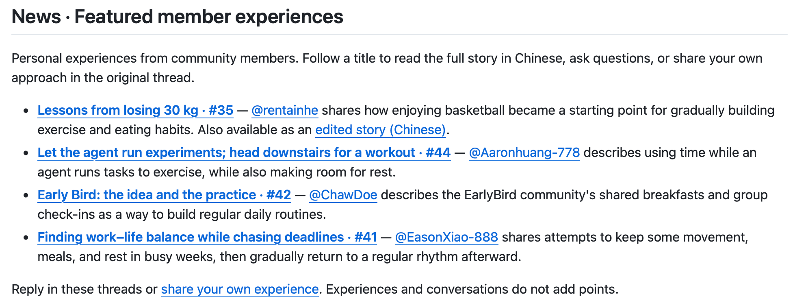

# Ten Years in AI Research: The Models Keep Getting Stronger. What About Us?

I've always believed that AI should make life better.

But as an AI researcher, I've felt a growing disconnect over the past few years. The technology keeps improving, and we can do more than ever, but our own lives don't necessarily feel any better.

There's always another paper to read, another experiment to run, another piece of code to write. Just when a project seems nearly finished, a new direction, model, or deadline comes along. When things get busy, meals, sleep, and exercise are often the first things pushed aside. Some colleagues around me are doing excellent research, yet seem increasingly exhausted. It makes me wonder: does the better life we expect AI to bring include the people working on it?

In 2016, I was a college senior just getting into AI research. Most of the research I was exposed to then was on image classification, object detection, and segmentation. I was excited about the field and looking forward to life in graduate school.

Over time, I found that research was fascinating, but the pace was more demanding than I'd imagined. When an experiment wasn't working, I'd want to try one more thing. When a paper deadline approached, cutting back on sleep for a few days could seem reasonable. Exercise easily became something I'd get back to “once things calmed down.” But there was always something else.

I've never been comfortable with sacrificing health over the long term for research. Knowing that and actually organizing my life around it are two different things. Over the past ten years, I've kept adjusting my sleep, training, and eating habits, trying to find a way to take research seriously while taking care of myself.

Ten years on, my research has accumulated **12,000 citations on Google Scholar**, and my physique and fitness are still much the same as they were a decade ago. Along the way, I've found a few things that work for me. I'd like to share them with fellow researchers.

1. **What kind of exercise fits into a researcher's life?**

For me, it comes down to cardiovascular fitness, strength, and recovery.

Running, swimming, and basketball are all worth making room for. Regular exercise supports cardiovascular fitness and long-term heart health. Sleep deserves attention too. Working out isn't a free pass to keep cutting sleep.

I also value strength training. I personally prefer compound exercises such as pull-ups and parallel-bar dips, which work several muscle groups at once. I'm not particularly focused on muscle size or maximum lifts. For me, “lean muscle” describes a state I enjoy: being strong, moving well, and keeping training and recovery manageable alongside research and everyday life.

I pay attention to whether I can work normally after a session, how I sleep that night, and how I feel the next day. Finding an amount of training I can sustain matters more to me than any single especially hard workout.

2. **How do I adjust training around paper and project deadlines?**

This is familiar territory for AI researchers. When time is tight and work piles up, I first look at how much sleep I'm getting and how tired I feel. Then I adjust my training, with three things in mind.

First, **cut back on high-intensity training and efforts near my limits.** When I'm short on sleep or noticeably fatigued, I reduce heavy squats, all-out sprints, and repeated sets to failure. I adjust the weights or number of sets to how I feel that day. Even when a workout is shorter, I still leave enough rest between sets.

Second, **save technically demanding movements for when I'm less tired.** Power cleans, for example, require speed, coordination, and precise control. I'd rather do them when I feel physically and mentally ready. During busy periods, I favor exercises I know well and can perform with control.

Third, **make time for sleep first.** If finishing my planned workout means going to bed even later, I shorten it or move it to another day. I also don't force myself to wake up early and lose sleep just to log a workout. If I feel off, I can finish early or rest. If I need a week or two off, there's no need to panic; I can ease back in once I've recovered.

3. **Getting back to training after a deadline**

Once the deadline is over, I first get my sleep schedule and meals back into a routine. Then I gradually return to exercise, giving myself time to adjust and avoiding the urge to make up for every missed workout at once.

After a break or a period of reduced training, I usually start with low-intensity cardio. For strength training, I restart at roughly 60–70% of my usual working weights from before the break, then build back up depending on how I feel.

4. **Eating well when time is short**

Even when I'm busy, I try to keep an eye on how much oil and salt I'm eating. Takeout is convenient, but regularly choosing heavily salted, oily dishes can make it easy to consume more of both than I realize. Too much salt can also contribute to puffiness. I try to choose lighter, balanced meals so that convenience and taking care of myself can go together.

I also keep salmon and chicken breast in the fridge. When I'm busy, I can cook them through in an air fryer or microwave without much fuss. It's convenient, and I can control how much oil and salt I use.

5. **Where did all the time AI agents saved us go?**

This is something I've especially wanted to discuss lately. Agents can help us read papers, write code, and organize results. So why do we seem even busier after starting to use them?

My impression is that agents let us iterate faster, but more experimental results also take more effort to analyze. Agents also generate more code, faster, which leaves more for us to review, understand, and fix.

A friend shared a post called [“While My Agent Runs Experiments, I Head Downstairs for a Workout”](https://github.com/Al-LeanMuscle-Club/AI-LeanMuscle-Club/issues/44). They describe spelling out the task and how to check the results, letting the agent run independently for a while, and using that time to exercise.

I'd like to keep exploring this with others: which tasks actually save us time once checking and rework are included? Can some of that time go toward exercise and rest? Gradually collecting approaches that work could be useful for all of us.

6. **Exercise may help us see research problems differently**

Research involves a lot of exploration. More hours don't guarantee progress; fresh ideas matter too. When we're stuck, stepping away to exercise may help us see beyond the approach we've been repeating. Light activities such as walking can leave room for thoughts to wander and for new connections to form between papers we've read and experiments we've run. Exercise can also help us relax and reset, so we sometimes return with more energy and patience to think. Any new idea still needs to be checked against the literature and tested in experiments.

**Looking back**

Looking back on these ten years, I'm still doing research I enjoy, and I've largely maintained my physique and fitness. For me, continuing to make room for exercise and life outside work is worthwhile.

That's why I started the [**AI Lean Muscle Club**](https://github.com/Al-LeanMuscle-Club/AI-LeanMuscle-Club). I want to share my experience and hear what other AI researchers do, so we can work out routines that fit our lives.

The [**AI Lean Muscle Club**](https://github.com/Al-LeanMuscle-Club/AI-LeanMuscle-Club) gives us a place to log workouts, discuss how we fit training around research, and keep useful experiences easy to find. If you're new, you can start by reading members' posts, sharing what works for you, or joining the check-ins.

After a busy stretch or a break from training, you're always welcome back. I hope we can remind and support one another, and keep some room for exercise and rest.

*A few experiences shared by club members. The screenshot is in Chinese.*

The models will keep improving. I hope we have the energy to enjoy our own lives, too.

Train models. Train your body.
