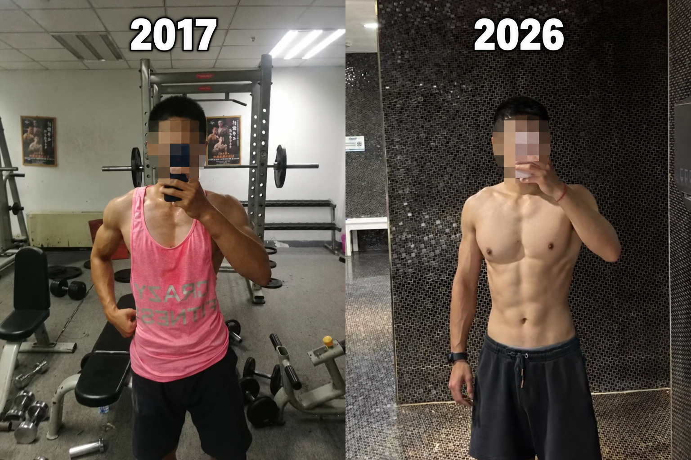
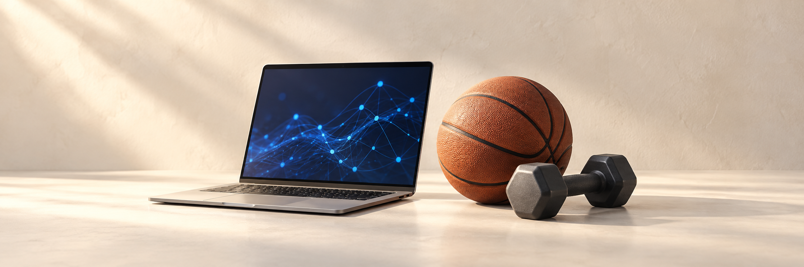
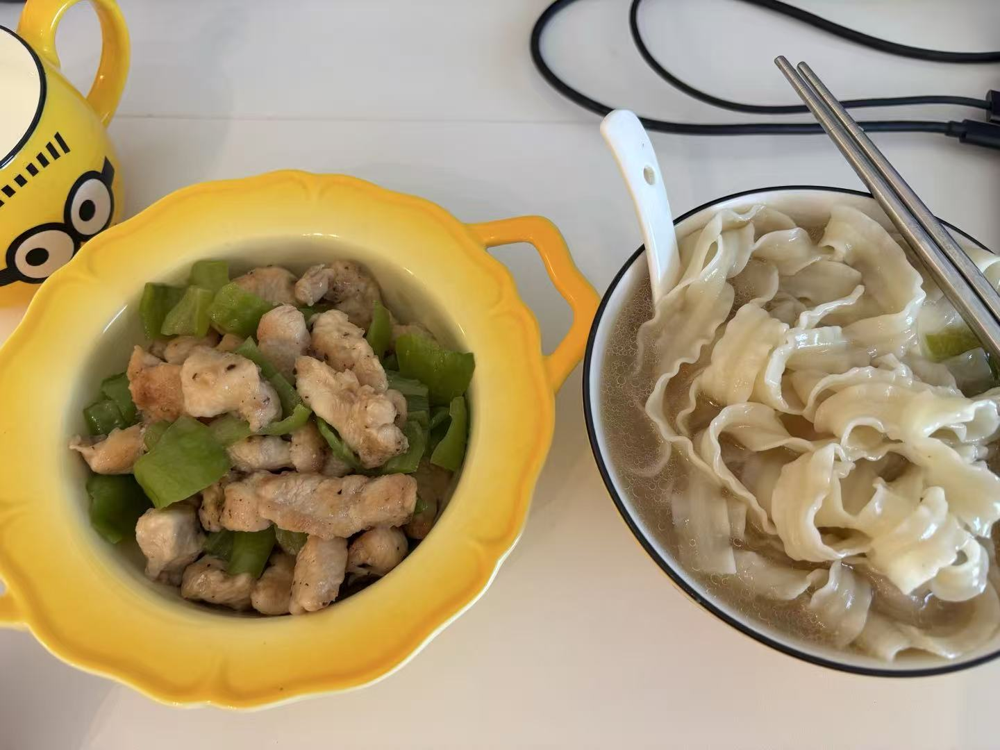
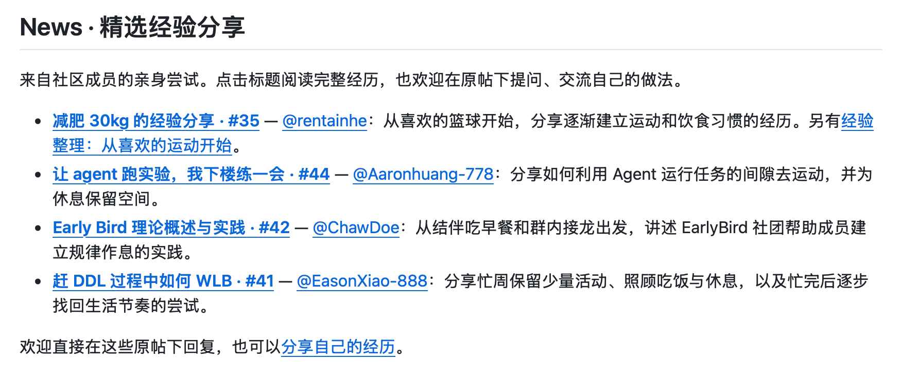

# 研究 AI 十年了，模型越来越强，我们自己呢？

我一直觉得，AI 的发展应该是为了让生活质量更好。

但作为一个做 AI 研究的人，这几年我越来越常感受到一种矛盾：技术进步很快，能做的事情越来越多，自己的生活却未必跟着变好了。

论文读不完，实验跑不完，代码写不完。刚觉得一个项目差不多了，又有新的方向、新的模型、新的 deadline。忙起来以后，最容易被往后放的就是吃饭、睡觉和锻炼。我身边有些同行，研究做得很好，人却越来越疲惫。看着这些变化，我也会想，我们期待 AI 带来的更好的生活，到底有没有包括自己？

2016 年，我大四，刚开始接触 AI 研究。当时我接触最多的还是图像分类、检测和分割，对这个领域充满期待，也憧憬着以后的研究生生活。

后来慢慢发现，研究很有意思，但节奏也比想象中紧张。一个实验没有结果，会想再试一下；一篇论文快到 deadline，会觉得这几天少睡一点也没关系。锻炼很容易变成一件“等忙完再说”的事，可下一件事总会接上来。

我一直不太认可为了做研究而长期牺牲健康。只是想明白这一点，和真正安排好生活，是两回事。这十年里，我也一直在调整作息、锻炼和饮食，试着找到一个既能认真做研究、又能照顾好自己的节奏。

十年过去，我的科研工作积累了 **1.2 万 Google Scholar 引用**，身材和运动表现也基本维持在十年前的水平。这些年慢慢积累了一些适合自己的做法，想借这个机会和同行分享。

1. **什么样的运动，更适合我们的科研生活？**

对我来说，适合科研生活的运动，需要兼顾心肺、力量和恢复。

跑步、游泳、篮球等运动，我觉得都值得保留。规律运动有助于保持心肺能力和长期心血管健康。不过，锻炼和睡眠都需要认真安排，不能觉得平时有运动，就可以放心熬夜。

力量训练我也很重视，个人更偏爱引体向上、双杠臂屈伸这类多关节复合动作，一个动作会用到多个肌群。至于肌肉围度和极限重量，我没有特别强的追求。我理解的“薄肌”，更多是自己喜欢的一种状态：有力量，运动起来灵活，训练和恢复的投入也能跟工作、生活协调好。

我也会留意练完之后还能不能正常工作、当晚睡得怎么样、第二天恢复得如何。找到自己能长期坚持的训练量，比某一次练得特别猛更重要。

2. **赶 paper 或 project deadline 时，训练怎么调整？**

这个问题对 AI researcher 太常见了。时间紧、事情多的时候，我会先看睡眠和疲劳情况，再调整训练，主要注意三件事。

首先，**减少高强度、接近极限的训练。** 睡眠不足、疲劳明显时，我会减少大重量深蹲、全力冲刺和反复练到力竭的安排，按当天状态降低负重或组数。训练时间缩短了，组间休息也要留够。

其次，**疲劳时减少技术难度高的动作。** 高翻这类动作，对速度、协调和动作控制都有要求。我更愿意把它们留到精神和身体状态比较好的时候做，忙碌期优先选择熟悉、容易控制的训练。

最后，**把睡眠时间先留出来。** 如果完成原定训练意味着进一步晚睡，就缩短或改天，也不必为了打卡而强行早起、压缩睡眠。当天状态不好，可以提前结束训练或直接休息。必要时暂停一两周，也不必过度焦虑，等状态恢复后再逐步练回来。

3. **赶完 deadline，怎么恢复锻炼？**

忙完以后，我会先把作息和吃饭调回来，再逐步恢复锻炼，给身体一点适应的时间，避免刚忙完就报复性地加练。

停练或减量之后，我一般会先从低强度有氧开始，力量训练则从停练前常用重量的 60%–70% 左右起步，再根据身体状态逐步恢复。

4. **忙的时候，怎么把饭吃得省事一点，也好一点？**

忙的时候，也要留意饮食里的油和盐。外卖虽然省事，但如果经常选择重油重盐的饭菜，很容易在不知不觉中摄入过多油盐，吃得太咸还可能引起浮肿。点餐时尽量选清淡一点、搭配均衡的饭菜，方便的同时，也把自己照顾好。

我平时也会在冰箱里备一些三文鱼、鸡胸肉，忙的时候用空气炸锅或微波炉简单做熟，吃起来方便，油盐也能自己控制。

5. **用了 Agent，省下来的时间去哪了？**

这是最近我尤其想和大家讨论的一个问题。Agent 可以帮忙读资料、写代码、整理结果，但怎么用上以后，反而更忙了？

我的感觉是，Agent 让任务迭代得更快，更多的实验结果也需要更多精力去分析；代码生成得更快、产出更多，人工审核、理解和返工的工作也跟着增加了。

有朋友写了一篇[《让 agent 跑实验，我下楼练一会》](https://github.com/Al-LeanMuscle-Club/AI-LeanMuscle-Club/issues/44)，分享了自己的安排：先把任务和检查方式交代清楚，让 Agent 能独立运行一段时间，再利用中间的空隙去运动。

我也想和大家继续试试：哪些任务交出去后，算上检查和返工，真的省了时间；这些时间又能不能有一部分留给运动和休息。能把这样的做法一点点积累下来，对我们应该很有用。

6. **运动也可能帮助科研打开思路**

科研有很强的探索性，进展很难靠堆工时保证，灵感和新思路同样重要。卡住时，出去运动一下，可能更容易跳出原来的思路。散步这类轻松活动，也给自由联想留出了空间，让读过的文献、做过的实验有机会产生新的联系。适量运动还能帮助放松、调整状态，回来之后，有时会更有精力和耐心继续思考。新想法是否成立，仍然需要回到文献和实验里验证。

**结尾**

回头看这十年，我还在做自己喜欢的研究，也基本保持了原来的身材和运动状态。对我来说，给锻炼和生活留出时间，是值得继续坚持的事。

这也是我发起 [**AI 薄肌俱乐部（AI Lean Muscle Club）**](https://github.com/Al-LeanMuscle-Club/AI-LeanMuscle-Club) 的初衷。我想分享自己的经验，也想听听其他 AI 科研同行的做法，一起摸索适合我们的生活节奏。

 [**AI 薄肌俱乐部（AI Lean Muscle Club）**](https://github.com/Al-LeanMuscle-Club/AI-LeanMuscle-Club)方便大家记录训练、交流科研与健身的安排，也把有用的经验留下来。第一次来，可以先看看成员的分享，再聊聊自己的做法，或者参与打卡。

忙过一阵、停练一段时间，都可以再回来。希望大家在这里能互相提醒、互相支持，给锻炼和休息留一点位置。

模型还会继续进步，我也希望我们有精力过好自己的生活。

Train models. Train your body.
