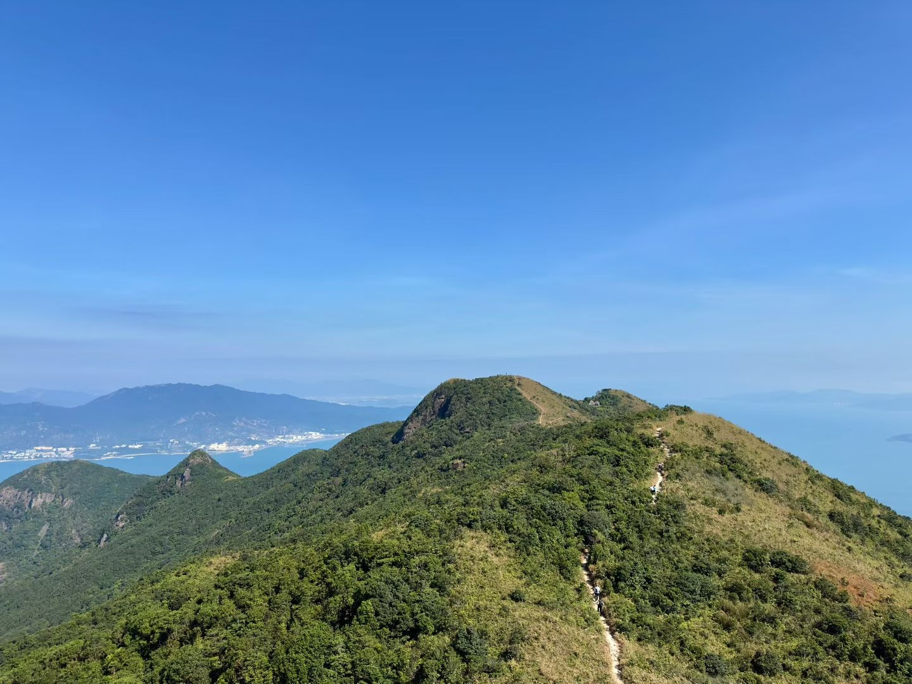

# 徒步分享

## 01｜开始：从一次阳朔徒步说起

去年，朋友邀请我一起去阳朔徒步。

两天，34 公里。一路翻山越岭，虽然身体很疲惫，但当站在大面山上，俯瞰眼前的山川与风景时，突然觉得一切都值得。

也是从那次开始，我逐渐喜欢上了徒步，开始主动探索大自然。

后来陆续走过一些路线，也推荐给对徒步感兴趣的朋友：

- **香港四大徒步径**：麦理浩径、凤凰径、卫奕信径、港岛径

- **深圳及周边**：七娘山、大雁顶、梧桐山、东西冲、银梅塘茶

每条路线都有不同的风景，也有不同的挑战。相比于打卡多少座山，我更享受的是走在山里的过程。

## 02｜准备：敬畏自然，量力而行

徒步看似简单，但并不是一件可以毫无准备就出发的事情。

分享几个我认为比较重要的准备事项：

- **路线规划**：提前通过「两步路」等工具了解路线、距离、累计爬升、预计耗时和撤离点，尽量下载离线轨迹。

- **装备准备**：根据路线准备登山杖、防滑登山鞋、护膝等装备，减轻长距离行走带来的负担。

- **食物与补给**：携带足够的饮用水、食物和必要的应急物品。

- **天气判断**：提前查看天气预报，遇到雷雨、台风或其他恶劣天气，及时调整计划。

- **日常训练**：平时可以通过靠墙静蹲、爬楼梯等方式锻炼腿部力量，逐步提升体能。

但我觉得，**最重要的还是量力而行，对大自然保持敬畏。**

新手尽量选择成熟、清晰、有保障的路线，不走野路，不盲目挑战超出自己体能的线路。山上的救援远比城市困难，一旦发生意外，可能付出很大的代价。

另外还有一个很重要的原则：**无痕山野，自己产生的垃圾一定要带走。**

享受自然的同时，也要尽可能减少对自然的打扰。

## 03｜收获：远离屏幕，让大脑真正休息

徒步带给我的最大收获，其实不是体能的提升，也不是征服一座又一座山，而是**能够真正放空自己。**

在 AI 时代，我们每天都在接收大量信息，处理各种问题。尤其对于程序员来说，大脑的 CPU 仿佛长期处于满负荷运行的状态。

工作时要思考需求、分析问题、编写代码、解决 Bug；下班后，手机和各种信息又不断占据我们的注意力。

很多时候，身体虽然休息了，大脑却没有真正停下来。

而徒步给了我一个很好的机会。

找一天时间，走进山里，暂时放下工作，远离代码和屏幕。

不需要处理消息，不需要思考复杂的问题，也不需要追求效率。

只需要专注于脚下的路，感受风、阳光、树木和山川。

走上六七个小时，身体可能很累，但精神反而会变得轻松。

慢慢地我也发现，**真正让人放松的，不一定是什么都不做，而是能够全身心地投入一件自己喜欢的事情。**

不一定非得是徒步。

阅读、骑行、摄影、游泳，或者任何能够让自己持续投入六到八个小时的爱好，都可能带来类似的感受。

重要的是，在这段时间里，我们能够暂时摆脱日常的信息和工作的牵引，把注意力重新交还给自己。

## 04｜最后

以前觉得休息就是躺着、刷手机、什么都不做。

后来才发现，有时候身体的疲惫，反而能够换来精神上的放松。

**徒步的意义，不在于走了多少公里、登上多高的山，而在于走进自然的那几个小时里，终于可以不用一直思考，单纯地感受生活。**

偶尔让大脑的 CPU 降降频，也是一种很好的自我充电方式。

阳朔夕阳：

